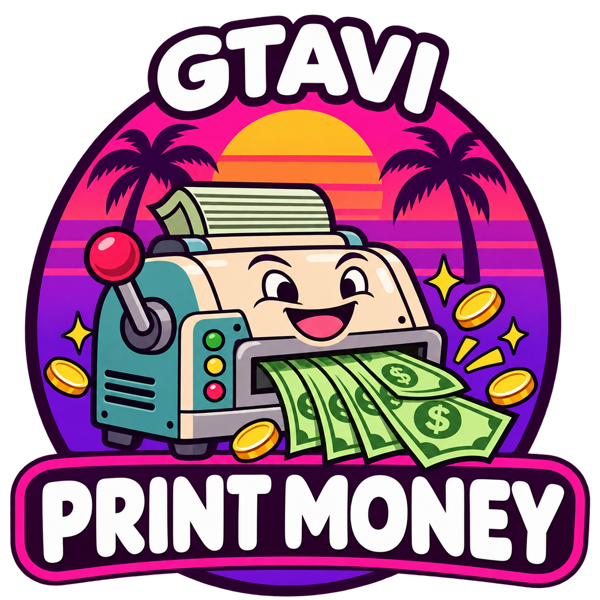

<p align="center"></p>

# GTAVI Print Money

**Bộ công cụ cắt clip GTA 6 chạy trong Claude Code.** Tìm video và stream GTA 6 đang hot, bắt đúng khoảnh khắc chat bùng nổ, cắt thành clip dọc 1080x1920 có phụ đề và hook, kiểm tra luật chiến dịch trước khi đăng. Có sẵn bản tiếng Việt.

<sub>Dự án fan không chính thức. Không liên quan tới Rockstar Games, Take-Two hay Anthropic.</sub>

## Cài đặt

```
/plugin marketplace add mcbaivn/gtavi-print-money
/plugin install gtavi-print-money@gtavi-print-money
```

## Bắt đầu

Mở Claude Code trong một thư mục riêng cho trang của bạn, rồi dán:

```
Dùng GTAVI Print Money. Thiết lập trang clip GTA 6 cho tôi, hỏi 4 câu trong một tin nhắn,
rồi sau một chữ "yes" thì làm hết: tìm chiến dịch clip đang mở, video và stream GTA 6 hot hôm nay,
tìm khoảnh khắc hay nhất trong video đầu bảng, cắt 3 clip đầu tiên có hook, kiểm tra luật chiến dịch,
và nói tôi nên đăng clip nào ở đâu.
```

## Kiếm tiền từ đâu

1. **Chiến dịch clip trả theo view.** Streamer và nhãn hàng trả tiền cho mỗi 1.000 view của clip được duyệt (Whop Content Rewards, Clip.tech…). Skill `campaign-finder` đọc mức giá, ngân sách còn lại và luật trực tiếp từ trang, không đoán số.
2. **Trang GTA 6 của riêng bạn.** Lớn dần nhờ đăng nhanh, mẹo hữu ích và clip có ghi nguồn. `playbook` lo lịch đăng mỗi ngày, `learning-loop` ghi số liệu thật.

Không có cam kết thu nhập. Kết quả phụ thuộc tốc độ, chọn clip và hook.

## Các skill

| Skill | Làm gì |
|---|---|
| `setup` | Cài ffmpeg, yt-dlp, faster-whisper, hỏi 4 câu, tạo thư mục trang |
| `campaign-finder` | Chiến dịch đang mở: giá / 1K view, ngân sách, luật, link |
| `trend-radar` | Video GTA 6 trong 24h, xếp theo view mỗi giờ |
| `stream-finder` | Ai đang stream GTA 6, xếp theo người xem |
| `moment-finder` | Khoảnh khắc 15–40 giây hay nhất: âm thanh, từ "hype", "most replayed", đỉnh chat |
| `live-mode` | Ghi stream đang live, tự cắt clip mỗi lần chat bùng nổ |
| `twitch-reaction` | Clip reaction: mặt streamer trên, game dưới, tiêu đề lớn ở giữa; tự tìm webcam |
| `clip-cutter` | Clip 1080x1920, phụ đề từng từ, khung hook, −14 LUFS |
| `hook-writer` | 3 lựa chọn hook cho mỗi clip |
| `rule-check` | Kiểm tra độ dài, định dạng, hashtag, nội dung cấm |
| `multilang` | Một clip ra nhiều ngôn ngữ: ES, PT, DE, RU, **VI**; có giọng đọc hook |
| `questions-to-posts` | Câu hỏi lặp lại trên Reddit và bình luận → bài HOW TO |
| `secrets-map` | Kho địa điểm bí mật, xe hiếm, đồ sưu tầm, có mốc thời gian và nguồn |
| `cheat-codes` | Cheat code đã được báo cáo, kèm nguồn, thành carousel 4 slide |
| `playbook` | Lịch làm việc hằng ngày và kế hoạch ngày ra mắt |
| `learning-loop` | Bảng điểm, mỗi ngày một thử nghiệm, thu nhập từ số liệu thật |

Không có gì được đăng tự động. Bạn duyệt từng bài.

## Luật cứng

Không leak, không "chơi sớm" / "tải miễn phí", không lậu, không bot tiền GTA Online, không tin giả, không giả danh Rockstar. Mọi thông tin phải có nguồn chính thức. Luôn ghi nguồn clip gốc và thêm hook hoặc bình luận riêng.

## Chạy script trực tiếp

```
pip install -r requirements.txt
python scripts/trends.py --query "gta 6" --hours 24
python scripts/streams.py --query "gta 6"
python scripts/moments.py "https://www.youtube.com/watch?v=..." --top 8
python scripts/cut.py jobs/<id> --pick 2 --layout facecam --hook "Không ai để ý chỗ này"
python scripts/translate.py jobs/<id> --pick 2 --langs vi --voice
python scripts/check.py jobs/<id>/edits/clip_2.mp4 --campaign campaigns.md
python scripts/live.py "https://www.youtube.com/watch?v=<live>" --minutes 60
```

Windows, macOS hoặc Linux, Python 3.10+. Có GPU NVIDIA thì nhận dạng giọng nói nhanh hơn.

Giấy phép MIT, xem [LICENSE](LICENSE).
